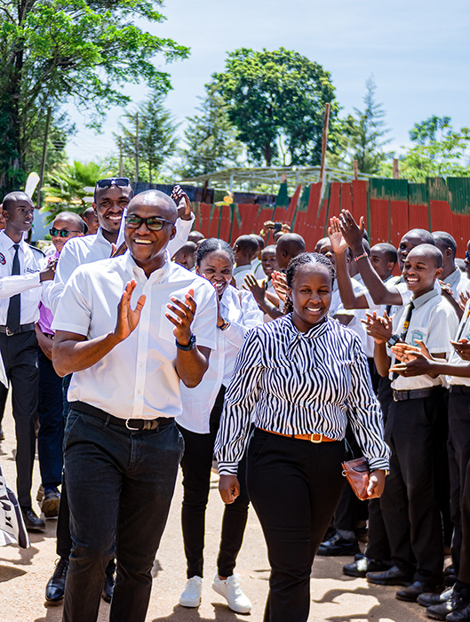
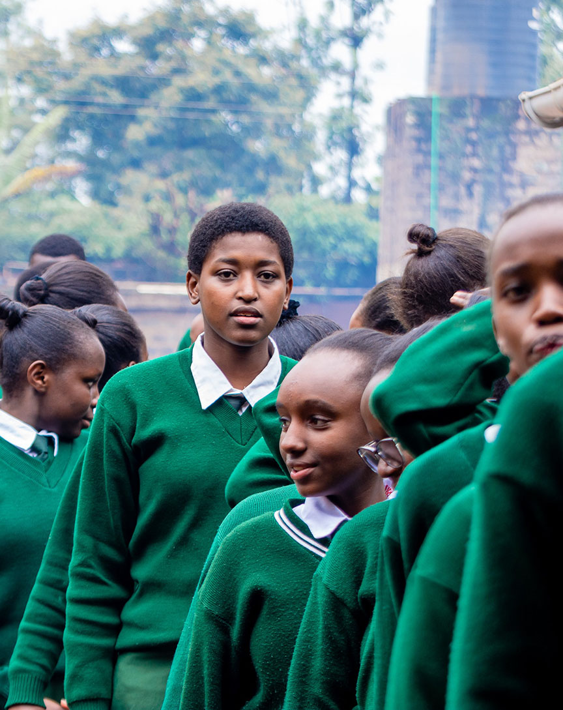

###### About the movement

## Building a Diverse Alumni Movement

Founded in October 2021 as a response to the financial hardships faced by Kenyan schools during the Covid-19 pandemic, Alumni Challenge emerged with the primary aim of providing financial assistance to these struggling educational institutions. However, it quickly evolved into a dynamic movement that seeks to address educational disparities and foster a culture of engaged alumni committed to making a difference in their communities.

At Alumni Challenge, we firmly believe that alumni possess a wealth of resources beyond financial contributions. We offer hope in a world grappling with various challenges. To engage and unite alumni, we recognize the power of sports as a compelling avenue for promoting our message and fostering collaboration. Our vision is to cultivate a diverse alumni movement spanning all 47 counties in Kenya and Africa, working collectively to ensure equitable access to quality education and creating a lasting impact on society.

2

Years of
Service

8000

Persons
Reached

11

Events &
Programmes

27

Alumni
Partners

# Our Mission & Vision

### Our Vision

To unite alumni across Africa in transforming education access and creating lasting impact for future generations

### Our Mission

To create tangible impact in learning institutions by encouraging alumni participation through different sports and social avenues.

## Our History

Alumni Challenge aims to promote equitable access to quality education across the Kenya & Africa by mobilizing resources through the Alumni which may include, but are not limited to:

- Bursary funds
- Lifelong learning opportunities for students
- Teacher welfare/reward programs
- Social research & advocacy
- Institutional development
