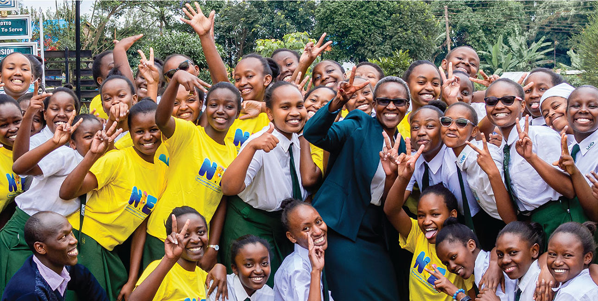
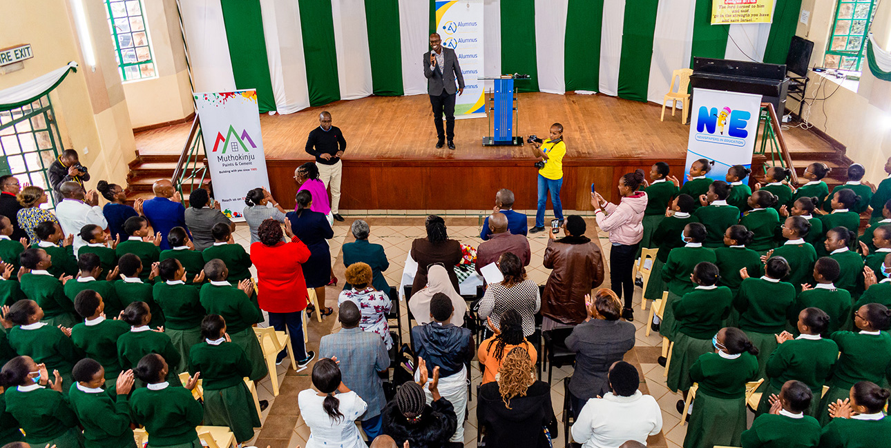
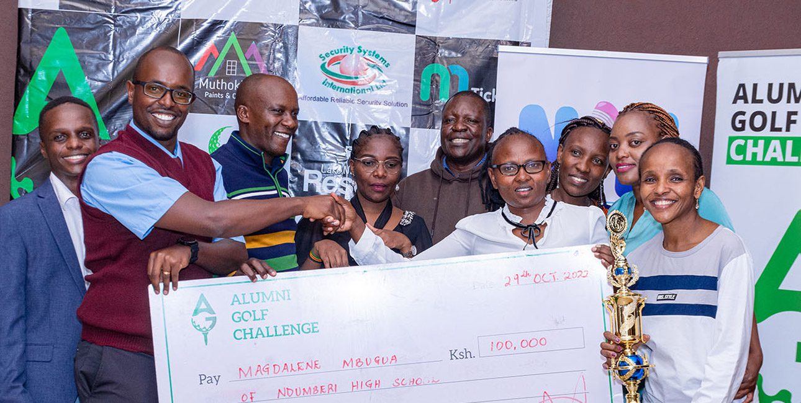
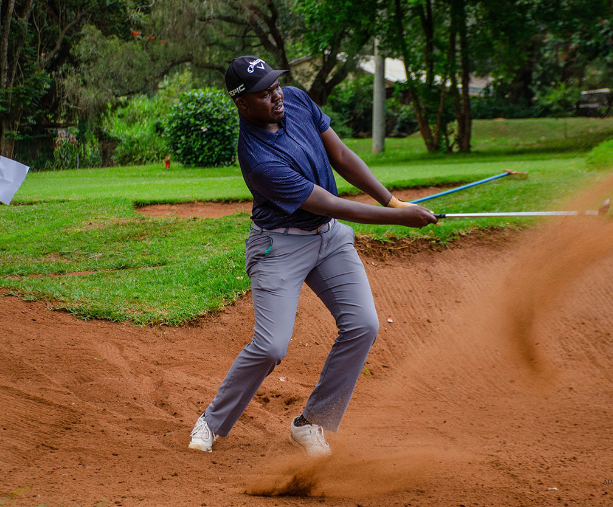

  <!-- background image -->

  <!-- background image -->

  <!-- background image -->

  <!-- background image -->

- Inspiring the Future. Golf for a course [Read More](https://alumnichallenge.foundation/programs/)
- Inspiring the Future. Empowerment programs Read More
- Inspiring the Future. Mentorship & Leadership Training Read More
- Inspiring the Future. Bursary for the disadvantaged Read More

## Founded in 2022

Promoting A Transformative Alumni Culture

#### About Organization

### Igniting the Alumni Movement in the Education Space

Welcome to The Alumni Challenge, a non-profit organization dedicated to igniting the alumni movement within the education sector.

- Our primary objective is to champion equitable and high-quality education for marginalized communities in Kenya. We firmly believe that alumni, armed with their firsthand knowledge of the challenges faced by the education system, possess the power to effect transformative change.
- Our approach encompasses a comprehensive strategy that integrates sports and social initiatives. Through impactful events like the Alumni Golf Challenge, we not only raise funds but also generate awareness for education projects in marginalized communities. These initiatives enable us to provide a range of support, including bursaries and endowment funds, opportunities for lifelong learning, programs to enhance teacher welfare, social research and advocacy, and institutional development.
- By harnessing the untapped potential of alumni, our aim is to create sustainable, long-lasting improvements and ensure that every community in Kenya has access to education of the highest quality. We invite you to join us in our mission to revolutionize lives through education and empower future generations. Together, we can make a significant difference.

# 01

[Donate Now](https://alumnichallenge.foundation/contact/)

# 02

[Volunteer](https://alumnichallenge.foundation/contact/)

# 03

[Newsletters](https://alumnichallenge.foundation/contact/)

# 04

[Get Involved](https://alumnichallenge.foundation/contact/)

Join the Alumni Movement Send us a message, or phone 0104 063 038 between 09:00 and 18:00 Mon-Sat.

[Request a Call Back](https://alumnichallenge.foundation/contact/)

#### We’re Specialized In

### Featured Programs and Events

[Latest Blog](https://alumnichallenge.foundation/blog/)

[Uncategorized](https://alumnichallenge.foundation/category/uncategorized/)

## [From St. Mary’s Alumnus To Archbishop: A Story Of Inspiration And Impact](https://alumnichallenge.foundation/2023/08/02/from-st-marys-alumnus-to-archbishop-a-story-of-inspiration-and-impact/)

[Uncategorized](https://alumnichallenge.foundation/category/uncategorized/)

## [Creating Lasting Change: How Alumni Involvement Can Help Break The Cycle Of Poverty](https://alumnichallenge.foundation/2023/08/02/creating-lasting-change-how-alumni-involvement-can-help-break-the-cycle-of-poverty/)

[Uncategorized](https://alumnichallenge.foundation/category/uncategorized/)

## [Bridging Borders With Golf: International Champion Propels Local School To Victory](https://alumnichallenge.foundation/2023/08/02/bridging-borders-with-golf-international-champion-propels-local-school-to-victory/)
