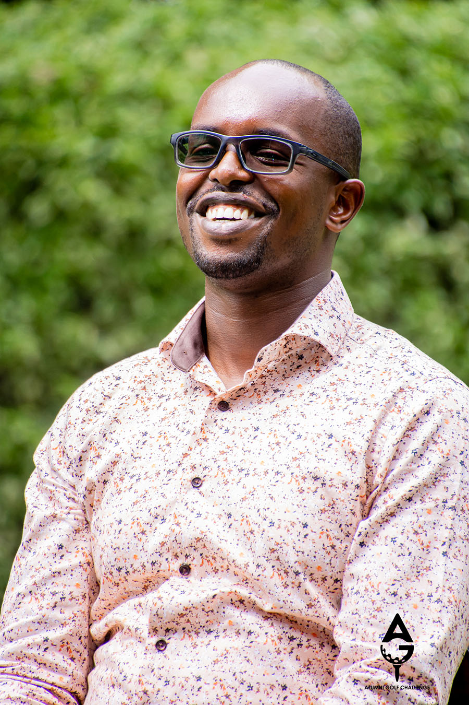
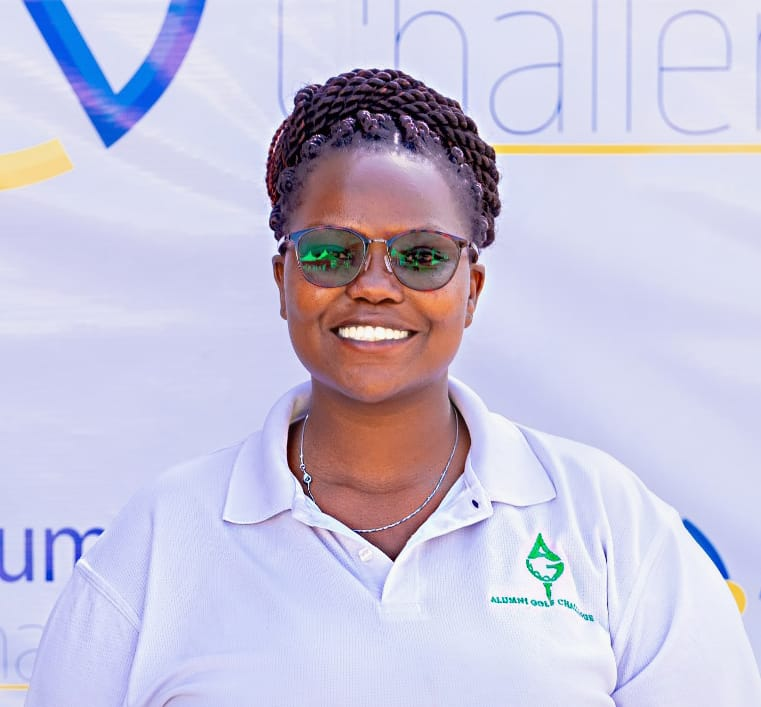
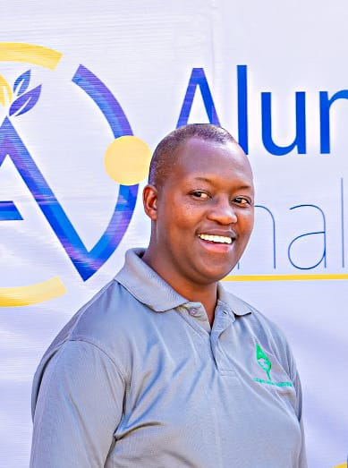
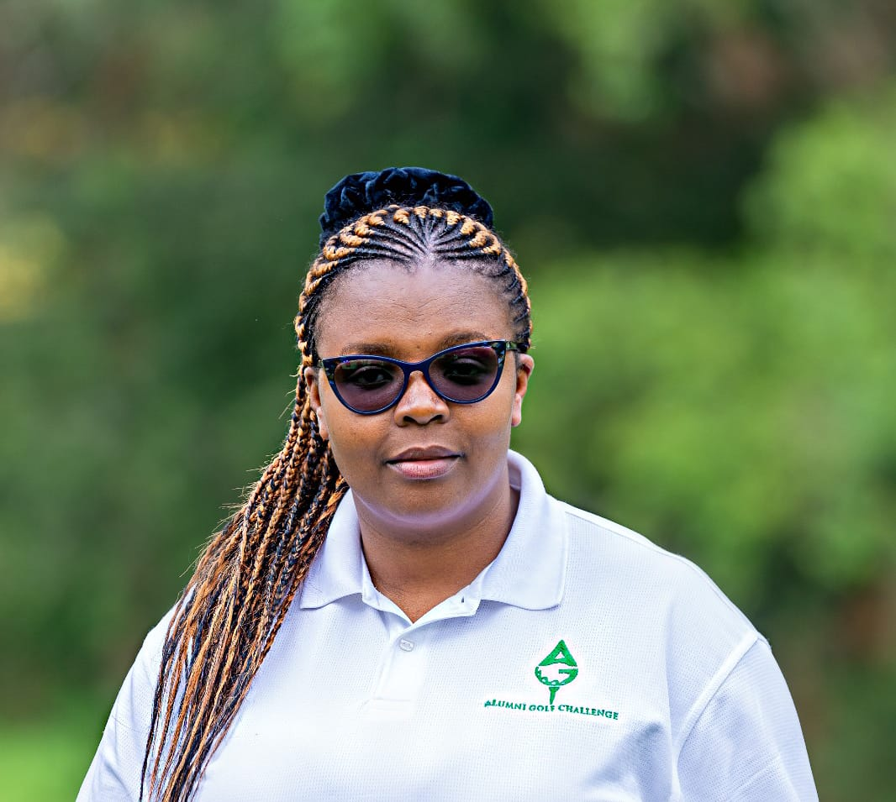

###### the Founder

Meet Mark Macharia, the visionary behind Alumni Challenge. As our founder and CEO, Mark brings a wealth of industry experience and a true passion for our mission. His leadership, strategic vision, and unwavering dedication have been vital to our success.

Before starting Alumni Challenge, Mark honed his skills in private sector management. With qualifications in marketing, public relations, and advertising, he has also pursued additional training in entrepreneurship, project management, and sales.

Mark’s personal journey as a beneficiary of alumni bursary support inspired him to create Alumni Challenge. After years of anticipation, he turned his vision into reality in 2022. With over 12 years of experience, Mark understands the challenges and opportunities in our field. He is committed to driving innovation, fostering collaboration, and ensuring the long-term sustainability of our organization.

Under Mark’s guidance, we have expanded our reach, formed valuable partnerships, and achieved remarkable milestones. Join us as we continue to make a difference under his inspiring leadership

### Mark Macharia

CEO & Co-Founder

#### OUR TEAM

### Alumni Lead Transformers

  <!-- background image -->

[Grace Mwende](https://alumnichallenge.foundation/team/grace-mwende/)

Admin Lead

  <!-- background image -->

[Jeremiah Mwangangi](https://alumnichallenge.foundation/team/jeremiah-mwangangi/)

Marketing Lead

  <!-- background image -->

[Beatrice Karomo](https://alumnichallenge.foundation/team/beatrice-karomo/)

Events Coordinator
